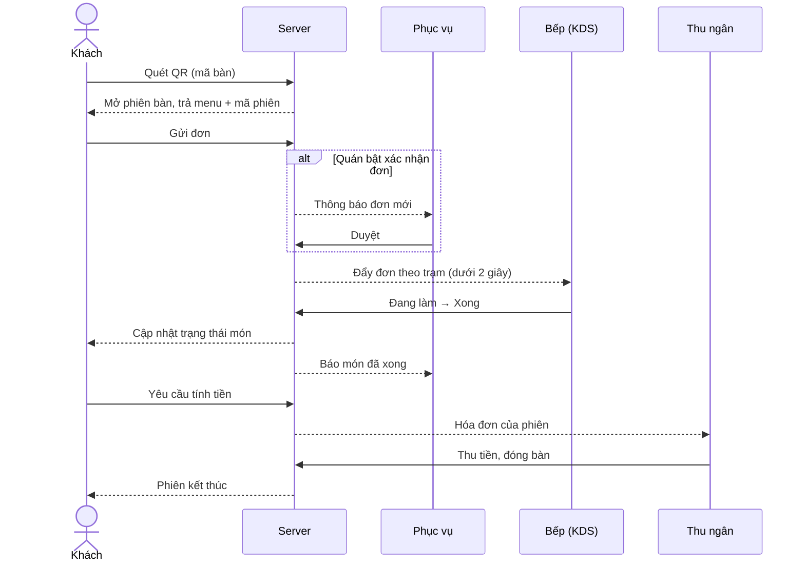
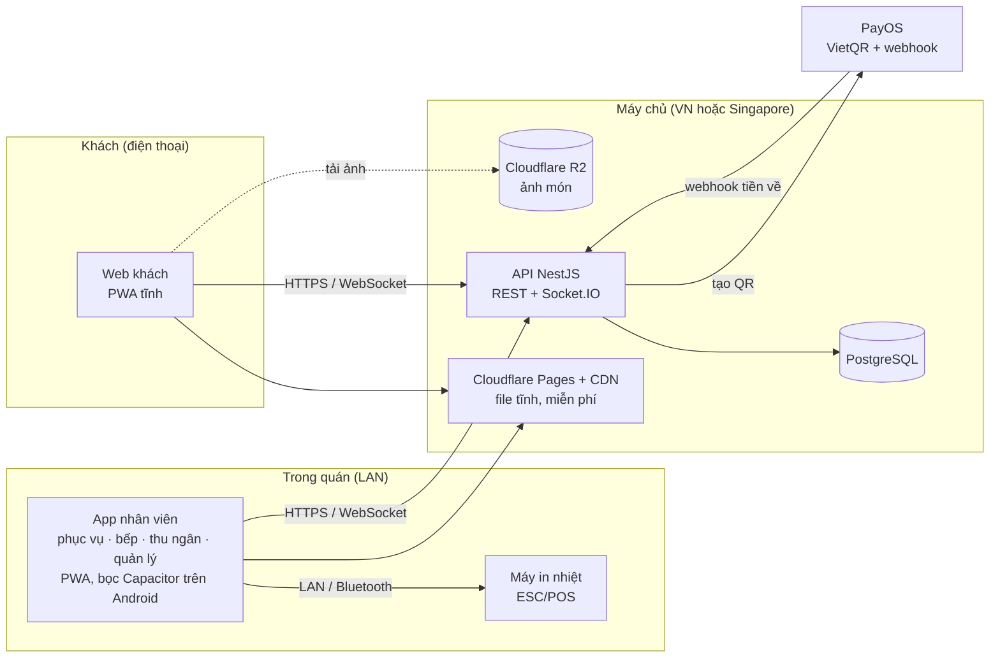

# Spec: Hệ thống gọi món QR tại bàn

23/10/2026 · @sansan · **Bản 2.1** (rà soát bản 1, bổ sung mục 7, 11, 12; đã chốt câu hỏi mở; bắt đầu implement)

## 1. Tổng quan & mục tiêu

Đây là một web app. Khách quét mã QR dán trên bàn để xem menu, gọi món và thanh toán mà không phải cài app. Đơn được chuyển thẳng xuống bếp và thu ngân theo thời gian thực. Mục tiêu MVP: chạy ổn định tại 3–5 quán thí điểm sau 16 tuần, mở bán rộng từ tuần 17.

**Vấn đề cần giải quyết**

- Giờ cao điểm quán thiếu người nhận order, khách phải chờ mới gọi được món và tính được tiền.
- Ghi order bằng tay dễ sai món, sai bàn, thiếu ghi chú cho bếp.
- Menu giấy tốn tiền in lại mỗi lần đổi giá hoặc hết món.

**Chỉ số thành công (mục tiêu đề xuất cho giai đoạn thí điểm)**

| Chỉ số | Mục tiêu | Cách đo |
| --- | --- | --- |
| Thời gian từ lúc khách quét QR đến lúc gửi đơn đầu tiên | dưới 3 phút | Log thời điểm mở phiên và thời điểm đơn đầu tiên |
| Tỷ lệ đơn đi qua QR trên tổng số đơn | từ 50% | Đơn có nguồn "khách" / tổng đơn trong phiên |
| Thời gian từ khi khách gửi đơn đến khi bếp thấy đơn | dưới 2 giây | Đo trên 95% đơn (p95), log ở client bếp |
| Quán thí điểm vẫn dùng sau 30 ngày | từ 60% | Quán có ít nhất 20 đơn QR trong 7 ngày gần nhất |

Ngoài phạm vi MVP: giao hàng, quản lý kho nguyên liệu, tích điểm khách hàng thân thiết, đặt bàn trước.

## 2. Người dùng & vai trò

Có năm vai trò trong quán. Chỉ khách là không cần đăng nhập.

| Vai trò | Thiết bị | Việc chính | Phạm vi dữ liệu |
| --- | --- | --- | --- |
| Khách | Điện thoại cá nhân, trình duyệt | Xem menu, gọi món, gọi phục vụ, thanh toán | Chỉ bàn đang ngồi, trong phiên đang mở |
| Phục vụ | Điện thoại hoặc tablet | Nhận thông báo, xác nhận đơn, gọi món hộ, chuyển và gộp bàn | Các bàn trong ca |
| Bếp / Bar | Tablet (Android từ 10 inch) | Xem món theo trạm, cập nhật trạng thái, báo hết món | Món thuộc trạm của mình |
| Thu ngân | Máy tính, tablet hoặc máy POS Android | Xem hóa đơn, giảm giá, thu tiền, in hóa đơn, đóng bàn | Hóa đơn của cửa hàng |
| Chủ quán / Quản lý | Web quản trị | Menu, bàn và QR, nhân viên, báo cáo, cấu hình | Toàn bộ cửa hàng hoặc chuỗi |

Ngoài ra có vai trò **quản trị hệ thống** phía bên bán phần mềm, dùng để tạo cửa hàng, gán gói cước và hỗ trợ kỹ thuật.

**Cách đăng nhập**

- Chủ quán, quản lý và quản trị hệ thống đăng nhập bằng email + mật khẩu (có thể thêm OTP qua Zalo/SMS ở P2).
- Thiết bị dùng chung của quán (tablet bếp, máy thu ngân, điện thoại phục vụ) đăng nhập **một lần** bằng tài khoản thiết bị của cửa hàng do quản lý tạo. Nhân viên đổi ca trên thiết bị đó bằng **mã PIN 4–6 số**. PIN chỉ có tác dụng trên thiết bị đã đăng nhập, không dùng được từ bên ngoài, nên PIN ngắn vẫn an toàn.
- Mọi thao tác của nhân viên (xác nhận đơn, giảm giá, đóng bàn) đều ghi lại ai làm, lúc nào.

## 3. Luồng chính

Một lượt khách đi qua 4 vai trò, 9 bước, từ lúc quét QR đến lúc đóng bàn.

1. Khách quét QR trên bàn, trình duyệt mở đúng cửa hàng và đúng bàn. Nếu bàn chưa có phiên, hệ thống mở phiên mới.
2. Khách chọn món, tùy chọn, ghi chú. Nhiều người cùng bàn thêm vào một giỏ chung.
3. Khách gửi đơn.
4. Nếu quán bật xác nhận đơn: phục vụ nhận thông báo, duyệt hoặc từ chối.
5. Đơn hiện trên màn hình bếp theo trạm (bếp, bar). Phiếu bếp tự in nếu quán có máy in (P1).
6. Bếp bấm "đang làm" rồi "xong". Khách và phục vụ thấy trạng thái ngay.
7. Phục vụ mang món ra. Khách gọi thêm thì lặp lại từ bước 2, vẫn trong cùng phiên.
8. Khách bấm "tính tiền" hoặc quét VietQR tại bàn (P1). Thu ngân thấy hóa đơn tổng hợp của cả phiên.
9. Thu ngân thu tiền và đóng bàn. Phiên kết thúc, link cũ trên điện thoại khách hết hiệu lực, bàn về trạng thái trống.



Phục vụ chỉ tham gia khi quán bật xác nhận đơn. Trạng thái món từ bếp hiện ngay trên điện thoại của khách, và khách có thể gọi thêm nhiều lần trước khi tính tiền.

**Quy tắc phiên bàn** (sửa so với bản 1: QR trên bàn là tĩnh, không thể đổi khi đóng bàn vì tem đã in)

- Tem QR dán trên bàn chứa **mã bàn đã ký số**, cố định. Quản lý có thể in lại tem với mã mới nếu nghi tem bị lộ.
- Khi quét, server cấp cho trình duyệt khách một **mã phiên** ngắn hạn gắn với phiên bàn đang mở. Mọi đơn phải kèm mã phiên hợp lệ. Đóng bàn thì mã phiên hết hiệu lực.
- Người giữ ảnh chụp QR quét lại sau khi bàn đã đóng sẽ mở một phiên mới. Để chặn đơn ảo, **đơn đầu tiên của mỗi phiên luôn cần phục vụ xác nhận**, mặc định bật, quán có thể tắt. Quán cũng có thể chọn chế độ "phục vụ mở bàn", khi đó khách quét bàn trống sẽ thấy thông báo chờ nhân viên.
- Phiên không có hoạt động quá 4 giờ (cấu hình được) tự đóng để tránh phiên treo. Nếu còn đơn chưa thanh toán thì chuyển sang danh sách "cần xử lý" của thu ngân.

## 4. Yêu cầu chức năng

MVP gồm 17 chức năng P0, đủ để quán chạy trọn một vòng từ lúc gọi món đến lúc đóng bàn. P1 làm trong giai đoạn thí điểm, P2 làm khi mở rộng.

| Mã | Nhóm | Chức năng | Mô tả | Ưu tiên |
| --- | --- | --- | --- | --- |
| K1 | Khách | Mở menu qua QR | Quét QR là mở đúng cửa hàng và đúng bàn, không cài app, không đăng nhập | P0 · MVP |
| K2 | Khách | Xem menu | Danh mục, ảnh, giá, mô tả, nhãn (cay, chay, bán chạy); món hết tự ẩn | P0 · MVP |
| K3 | Khách | Tùy chọn món | Size, topping, mức đường đá, ghi chú cho bếp | P0 · MVP |
| K4 | Khách | Giỏ hàng chung và gửi đơn | Nhiều người cùng bàn thêm vào một giỏ; gọi thêm nhiều lần trong một phiên | P0 · MVP |
| K5 | Khách | Theo dõi trạng thái | Đã nhận, đang làm, đã ra món, cập nhật realtime | P0 · MVP |
| K6 | Khách | Gọi phục vụ, yêu cầu tính tiền | Một nút bấm, gửi thông báo tới phục vụ và thu ngân | P0 · MVP |
| K7 | Khách | Thanh toán VietQR tại bàn | VietQR động theo số tiền hóa đơn, tự đối soát qua webhook; hoặc chọn trả tại quầy | P1 · Sau MVP |
| K7b | Khách | Ví điện tử | MoMo, ZaloPay. Tách khỏi K7 vì cần hợp đồng merchant riêng với từng ví | P2 · Về sau |
| K8 | Khách | Đa ngôn ngữ | Tiếng Việt và tiếng Anh, quán nhập bản dịch cho từng món | P1 · Sau MVP |
| K9 | Khách | Đánh giá sau bữa ăn | 1–5 sao kèm góp ý, chủ quán xem trong báo cáo | P2 · Về sau |
| V1 | Phục vụ | Thông báo realtime | Đơn mới, gọi phục vụ, yêu cầu tính tiền, có âm báo | P0 · MVP |
| V2 | Phục vụ | Xác nhận đơn | Duyệt hoặc từ chối đơn trước khi xuống bếp; quán bật tắt trong cấu hình | P0 · MVP |
| V3 | Phục vụ | Gọi món hộ khách | Cho khách không dùng điện thoại | P0 · MVP |
| V4 | Phục vụ | Chuyển, gộp, tách bàn | Chuyển bàn, gộp bàn, tách hóa đơn | P1 · Sau MVP |
| B1 | Bếp | Màn hình bếp (KDS) | Món xếp theo thời gian, lọc theo trạm bếp hoặc bar, báo món chờ lâu | P0 · MVP |
| B2 | Bếp | Cập nhật trạng thái món | Đang làm, xong; khách và phục vụ thấy ngay. Món "xong" rời màn hình bếp; phục vụ bấm "đã mang ra" ở màn phục vụ | P0 · MVP |
| B3 | Bếp | In phiếu bếp | Tự in ra máy in nhiệt khi có đơn. Cần app Android hoặc máy in Bluetooth, xem mục 7 | P1 · Sau MVP |
| B4 | Bếp | Báo hết món | Món tự ẩn khỏi menu của khách | P0 · MVP |
| T1 | Thu ngân | Hóa đơn theo bàn | Tổng hợp mọi đơn trong phiên bàn | P0 · MVP |
| T2 | Thu ngân | Giảm giá, phụ thu, VAT | Theo % hoặc số tiền, theo món hoặc cả hóa đơn | P1 · Sau MVP |
| T3 | Thu ngân | Thu tiền và đóng bàn | Tiền mặt, chuyển khoản (thu ngân tự kiểm tra); đóng bàn thì phiên và mã phiên hết hiệu lực | P0 · MVP |
| T4 | Thu ngân | In hóa đơn | Tạm tính và hóa đơn bán lẻ ra máy in nhiệt, cùng cơ chế in với B3 | P1 · Sau MVP |
| T5 | Thu ngân | Hóa đơn điện tử | Kết nối nhà cung cấp hóa đơn điện tử | P2 · Về sau |
| Q1 | Quản lý | Quản lý menu | Thêm, sửa, xóa danh mục, món, tùy chọn, giá, ảnh; khung giờ bán; nhập nhanh từ file Excel | P0 · MVP |
| Q2 | Quản lý | Quản lý bàn và QR | Tạo khu vực, bàn; sinh QR, xuất PDF để in tem | P0 · MVP |
| Q3 | Quản lý | Nhân viên và phân quyền | Tạo tài khoản, gán vai trò, mã PIN, tài khoản thiết bị | P0 · MVP |
| Q4 | Quản lý | Báo cáo | Doanh thu theo ngày và giờ, món bán chạy, thời gian ra món | P1 · Sau MVP |
| Q5 | Quản lý | Nhiều chi nhánh | Menu chung, giá riêng từng chi nhánh, báo cáo gộp | P2 · Về sau |
| Q6 | Quản lý | Gói cước | Xem gói đang dùng, gia hạn, nâng cấp; thanh toán gói qua VietQR | P1 · Sau MVP |
| A1 | Quản trị hệ thống | Quản lý cửa hàng | Trang `/sys` riêng cho đội vận hành: danh sách mọi quán (chủ quán, gói, hạn, số bàn, đơn 7 ngày), tạo quán hộ khách, khóa/mở quán, đổi gói. Quán bị khóa: nhân viên không đăng nhập được, khách quét QR bị chặn. *Đã làm trước lộ trình ngày 30/10/2026 vì hệ thống cần tạo được nhiều quán ngay từ đầu* | P1 · Đã làm |
| A2 | Chủ quán | Tự đăng ký quán | Trang `/register`: tên quán, số bàn ban đầu, tài khoản chủ quán. Tạo xong có ngay khu vực "Khu chính" với bàn B1…Bn đủ mã QR, gói Miễn phí dùng thử 30 ngày, vào thẳng trang in tem QR. *Thêm ngày 30/10/2026, kéo từ giai đoạn 3 lên* | P0 · Đã làm |

## 5. Yêu cầu phi chức năng

Hai yêu cầu quan trọng nhất là đơn phải tới bếp trong vòng 2 giây và không ai được gọi món từ xa bằng ảnh chụp QR.

| Hạng mục | Yêu cầu |
| --- | --- |
| Hiệu năng | Menu tải xong dưới 2 giây trên 4G (gói JS trang khách dưới 200 KB nén); đơn tới màn hình bếp dưới 2 giây ở p95 |
| Tải | Mỗi cửa hàng tối đa 100 bàn (gói Cơ bản 30 bàn). Thiết kế cho 300 cửa hàng hoạt động đồng thời trong giờ cao điểm, tương đương 1.000 cửa hàng đăng ký trong năm đầu; khoảng 5.000 kết nối realtime đồng thời. Sửa so với bản 1 (200 bàn/cửa hàng) cho khớp với nhóm khách hàng quán nhỏ |
| Sẵn sàng | 99,5% mỗi tháng; không triển khai bản mới trong 11–13h và 18–21h |
| Sao lưu | Sao lưu cơ sở dữ liệu hàng ngày, giữ 30 ngày, lưu ở nơi khác máy chủ chính; mất dữ liệu tối đa 24 giờ, khôi phục trong 4 giờ. Phải có trước khi vào thí điểm |
| Chống đơn ảo | Mã bàn trong QR ký số, không đoán được; chỉ gọi món được khi có mã phiên hợp lệ của phiên đang mở; đơn đầu tiên của phiên cần phục vụ xác nhận (mặc định); giới hạn 5 đơn mỗi phút mỗi phiên |
| Bảo mật | HTTPS toàn bộ; phân quyền theo vai trò; mọi truy vấn đều lọc theo cửa hàng; không lưu thông tin thẻ; mật khẩu băm bằng Argon2 hoặc bcrypt |
| Mất mạng | Màn hình bếp và thu ngân báo rõ khi mất kết nối, khi có mạng lại tự tải lại danh sách đơn và gửi lại thao tác đang chờ; khách gửi đơn thất bại thì tự thử lại, không tạo đơn trùng (mỗi đơn có mã idempotency do client sinh) |
| Thiết bị | Chrome và Safari trong 2 năm gần nhất; màn hình bếp chạy trên tablet Android từ 10 inch, Android 10 trở lên |
| Dễ dùng | Khách gọi một món trong tối đa 4 lần chạm; chữ và nút đủ lớn cho người lớn tuổi (chữ nội dung từ 16px, nút từ 44px) |
| Định dạng | Tiền VND không lẻ; múi giờ Việt Nam (UTC+7); lưu trong DB theo UTC |
| Tuân thủ | Nghị định 13/2023 về bảo vệ dữ liệu cá nhân nếu thu số điện thoại của khách. MVP không thu bất kỳ thông tin cá nhân nào của khách |

## 6. Mô hình dữ liệu

Trục chính của dữ liệu là **phiên bàn**: mỗi lượt khách ngồi vào một bàn mở một phiên, mọi đơn và hóa đơn đều gắn vào phiên đó. Mọi bảng đều có `store_id` để tách dữ liệu giữa các cửa hàng, và mọi chỉ mục đều bắt đầu bằng `store_id`.

| Thực thể | Trường chính | Quan hệ |
| --- | --- | --- |
| Cửa hàng (Store) | tên, địa chỉ, slug, cấu hình (bật xác nhận đơn, ai mở bàn, VAT, ngôn ngữ, giờ tự đóng phiên), đang hoạt động, lý do khóa | có nhiều Bàn, Món, Nhân viên, một Thuê bao |
| Quản trị hệ thống (PlatformAdmin) | email, tên, mật khẩu băm | không thuộc Cửa hàng nào; quản lý mọi Cửa hàng |
| Thuê bao (Subscription) | gói (Miễn phí, Cơ bản, Chuyên nghiệp, Chuỗi), ngày bắt đầu, ngày hết hạn, trạng thái (Dùng thử, Đang dùng, Quá hạn, Đã hủy), lịch sử thanh toán | thuộc Cửa hàng |
| Khu vực (Area) | tên, thứ tự | thuộc Cửa hàng; có nhiều Bàn |
| Bàn (Table) | tên, qr_token, trạng thái (trống/đang dùng/khóa) | thuộc Khu vực; có nhiều Phiên bàn |
| Phiên bàn (TableSession) | mở lúc, đóng lúc, số khách, trạng thái (open/closed), session_secret | thuộc Bàn; có nhiều Đơn, Yêu cầu phục vụ và một Hóa đơn |
| Danh mục (Category) | tên vi/en, thứ tự, khung giờ bán | có nhiều Món |
| Món (MenuItem) | tên vi/en, mô tả, giá, ảnh, trạm (bếp/bar), nhãn, còn hàng, thứ tự | thuộc Danh mục; có nhiều Nhóm tùy chọn |
| Nhóm tùy chọn (ModifierGroup) | tên, bắt buộc hay không, chọn tối thiểu/tối đa | thuộc Món; có nhiều Tùy chọn |
| Tùy chọn (Modifier) | tên, giá cộng thêm, còn hàng | thuộc Nhóm tùy chọn |
| Đơn (Order) | số thứ tự trong ngày, nguồn (khách/phục vụ), trạng thái (chờ duyệt/đã nhận/từ chối/hủy), idempotency_key, tạo lúc, ai duyệt | thuộc Phiên bàn; có nhiều Dòng đơn |
| Dòng đơn (OrderItem) | món, số lượng, tùy chọn đã chọn (snapshot), giá tại lúc đặt, ghi chú, trạm, trạng thái bếp (chờ/đang làm/xong/đã ra) | thuộc Đơn |
| Hóa đơn (Bill) | tạm tính, giảm giá, phụ thu, VAT, tổng, trạng thái (mở/đã thu/hủy) | thuộc Phiên bàn; có nhiều Thanh toán |
| Thanh toán (Payment) | phương thức, số tiền, mã giao dịch, nội dung chuyển khoản, trạng thái, webhook_payload | thuộc Hóa đơn |
| Yêu cầu phục vụ (ServiceRequest) | loại (gọi phục vụ/tính tiền), tạo lúc, ai xử lý, xử lý lúc | thuộc Phiên bàn |
| Nhân viên (Staff) | tên, vai trò, email (nếu đăng nhập web), mã PIN băm, đang hoạt động | thuộc Cửa hàng |
| Thiết bị (Device) | tên (ví dụ "Tablet bếp 1"), loại, refresh token, lần cuối online | thuộc Cửa hàng |
| Nhật ký (AuditLog) | ai, làm gì, trên bản ghi nào, lúc nào | thuộc Cửa hàng |

Dòng đơn lưu lại giá và tùy chọn tại lúc đặt, nên khi quán đổi giá thì hóa đơn cũ không bị thay đổi. Các trạng thái (enum) được khai báo một lần trong gói `shared` và dùng chung cho API lẫn frontend (xem mục 11).

## 7. Kiến trúc & công nghệ đề xuất

**Nguyên tắc chọn công nghệ** cho đội 2 lập trình viên và mục tiêu chi phí vận hành thấp:

1. Một ngôn ngữ (TypeScript) cho toàn bộ frontend, backend và gói dùng chung.
2. Ít dịch vụ phải vận hành nhất có thể. Giai đoạn thí điểm chạy toàn bộ trên **một máy chủ ảo (VPS)** với Docker Compose. Chỉ thêm Redis, cơ sở dữ liệu quản lý (managed) khi số liệu bắt buộc.
3. Frontend là file tĩnh, host miễn phí trên CDN. Trang khách không cần SEO vì chỉ vào qua QR, nên không cần render phía server.
4. Có đường nâng cấp lên 1.000 cửa hàng mà không phải viết lại: thêm máy chủ API, chuyển Postgres sang managed, bật Redis adapter cho realtime.



Sửa so với bản 1: gộp app nhân viên và web quản trị thành **một frontend** phân quyền theo vai trò, còn **hai frontend + một API** thay vì ba. Trang khách tách riêng vì cần gói JS nhỏ nhất có thể; app nhân viên và quản trị dùng chung thư viện giao diện, chung đăng nhập, và chỉ có một bản build phải triển khai và bọc Capacitor.

| Thành phần | Đề xuất | Lý do | Chi phí |
| --- | --- | --- | --- |
| Web khách | React 19 + Vite, PWA (vite-plugin-pwa), TanStack Query, Tailwind | Gói nhỏ, cache menu offline, không cần server render. Bỏ Next.js so với bản 1 vì không cần SEO và không muốn vận hành thêm một tiến trình Node | 0đ (Cloudflare Pages) |
| App nhân viên + quản trị | Cùng stack với web khách, thêm shadcn/ui, TanStack Router; bọc **Capacitor** để ra APK Android cho tablet bếp và thu ngân | Một codebase cho mọi màn hình nhân viên; APK là cách duy nhất để in qua LAN (xem dưới) | 0đ (Cloudflare Pages); 25 USD một lần nếu lên Google Play, không bắt buộc, có thể cài APK trực tiếp |
| Backend | Node.js 22 LTS + **NestJS** (Fastify adapter), Prisma, Zod, Swagger | Khung có cấu trúc rõ cho đội nhỏ, nhiều người biết, dễ tuyển. Sinh OpenAPI để tạo client tự động cho frontend | Chạy trong VPS |
| Realtime | **Socket.IO** gateway trong NestJS. Thí điểm chạy một tiến trình, không cần Redis. Khi lên 2 máy chủ API thì bật `@socket.io/redis-adapter` | Tự kết nối lại, có phòng (room) theo cửa hàng và trạm bếp; đẩy đơn dưới 2 giây | 0đ lúc đầu |
| Cơ sở dữ liệu | **PostgreSQL 16**, một database nhiều cửa hàng, tách bằng `store_id`. Thí điểm chạy trong Docker cùng VPS, sao lưu hàng ngày lên R2 bằng `pg_dump`. Chuyển sang managed khi quá 100 cửa hàng | Giao dịch an toàn cho đơn và hóa đơn; một DB rẻ hơn và dễ báo cáo gộp hơn tách DB theo quán | 0đ lúc đầu; managed 15–60 USD/tháng về sau |
| Việc chạy nền | `@nestjs/schedule` trong tiến trình (tự đóng phiên, báo cáo ngày). Chuyển sang BullMQ + Redis khi có Redis | Tránh thêm dịch vụ sớm | 0đ |
| Ảnh món | **Cloudflare R2**, resize bằng `sharp` lúc tải lên thành 3 cỡ | Không tính phí băng thông ra, 10 GB miễn phí | gần 0đ |
| Thanh toán | **PayOS** (VietQR động + webhook). Quán tự mở tài khoản PayOS, phí giao dịch quán trả trực tiếp cho PayOS | Có webhook báo tiền về, không cần hợp đồng ngân hàng riêng; mình không chạm vào dòng tiền của quán | 0đ về phía mình |
| Máy in | ESC/POS. Ưu tiên 1: máy in **Bluetooth** điều khiển từ Chrome Android qua Web Bluetooth (không cần APK). Ưu tiên 2: máy in **LAN** qua APK Capacitor có plugin TCP socket | Trình duyệt không mở được kết nối TCP, nên in LAN bắt buộc cần APK | Máy in 1–2 triệu, quán mua |
| Xác thực | JWT truy cập 15 phút + refresh token trong cookie httpOnly; mã phiên của khách là JWT ký chứa `store_id`, `table_id`, `session_id` | Tự viết trong NestJS, không phụ thuộc dịch vụ ngoài | 0đ |
| Hạ tầng | **1 VPS** 2 vCPU / 4 GB RAM, Docker Compose (api, postgres, caddy). Đặt tại Việt Nam (Viettel, VNG, Vietnix) hoặc Singapore (DigitalOcean, Hetzner). Caddy tự cấp HTTPS | Đủ cho 50 quán thí điểm; độ trễ dưới 50 ms | 300–600 nghìn/tháng |
| Triển khai | GitHub Actions build image, đẩy lên GHCR, deploy bằng **Dokploy** (hoặc Coolify) cài trên VPS. Nếu muốn ít lớp hơn: SSH + `docker compose pull && up` | Deploy bằng git push, rollback một nút, tự sao lưu Postgres lên S3/R2 | 0đ |
| Giám sát | Sentry (gói miễn phí) cho lỗi; Uptime Kuma tự host hoặc Better Stack miễn phí cho uptime; log Docker gửi Grafana Cloud miễn phí | Đủ cho đội nhỏ, báo qua Telegram/Zalo | 0đ |
| Kiểm thử | Vitest cho đơn vị; Playwright chạy trọn luồng quét QR → gọi món → bếp → đóng bàn trong CI | Luồng chính phải xanh trước mỗi lần deploy | 0đ (GitHub Actions miễn phí 2.000 phút/tháng) |

**Về in bếp và in hóa đơn (B3, T4)**: trình duyệt không mở được kết nối TCP tới máy in trong LAN, nên câu hỏi mở số 3 của bản 1 ("PWA có đủ không") được chốt như sau. Quán không in thì PWA là đủ. Quán cần in thì chọn một trong hai: mua máy in Bluetooth và dùng Chrome Android (Web Bluetooth, không cần cài gì), hoặc cài APK Capacitor để in qua LAN. APK cũng là cùng codebase, chỉ thêm lớp vỏ, nên không tốn thêm người.

**Đường nâng cấp theo quy mô** (chỉ làm khi số liệu giám sát bắt buộc)

| Mốc | Thay đổi | Chi phí ước tính/tháng |
| --- | --- | --- |
| Thí điểm, dưới 50 quán | 1 VPS, Postgres trong Docker, không Redis | 0,5–0,8 triệu |
| 50–300 quán | Tách Postgres sang managed có sao lưu tự động; VPS lên 4 vCPU / 8 GB | 1,5–2,5 triệu |
| 300–1.000 quán | 2 máy chủ API sau load balancer, Redis managed cho Socket.IO adapter và BullMQ, read replica cho báo cáo | 3–6 triệu |

Ở mốc 1.000 quán, doanh thu gói Cơ bản đã khoảng 150 triệu/tháng, chi phí hạ tầng dưới 5% doanh thu. Giá trên là ước tính tại thời điểm viết, cần kiểm tra lại với nhà cung cấp.

## 8. Gói giá & mô hình kinh doanh

Bán theo thuê bao tháng, không thu % trên giao dịch. Gói chủ lực là 149.000đ/tháng, nằm trong khoảng 99.000–299.000đ mà quán nhỏ ở Việt Nam đang chấp nhận. Đây là mức giá đề xuất, cần kiểm chứng lại khi chạy thí điểm.

| Gói | Giá đề xuất | Bao gồm |
| --- | --- | --- |
| Miễn phí | 0đ | Menu QR chỉ để xem, tối đa 10 bàn, có logo sản phẩm |
| Cơ bản | 149.000đ/tháng | Gọi món QR, màn hình bếp, thu ngân, tối đa 30 bàn |
| Chuyên nghiệp | 299.000đ/tháng | Không giới hạn bàn, VietQR tự đối soát, in bếp, báo cáo, tiếng Anh |
| Chuỗi | 249.000đ/chi nhánh/tháng, từ 3 chi nhánh | Mọi thứ trong gói Chuyên nghiệp, báo cáo gộp, hỗ trợ ưu tiên |

- Dùng thử miễn phí 14 ngày, không cần thẻ.
- Trả trước theo năm được giảm 20%.
- Bán kèm tablet, máy in nhiệt và tem QR theo giá vốn cộng phí lắp đặt, không tính vào thuê bao.
- Phí giao dịch VietQR (nếu có) quán trả trực tiếp cho PayOS theo hợp đồng của quán, không qua mình. Cần ghi rõ trong trang giá để tránh hiểu nhầm "không thu % giao dịch".
- Quán thí điểm dùng gói Chuyên nghiệp miễn phí 6 tháng đổi lấy phản hồi và quyền dùng tên quán trong tài liệu bán hàng.

## 9. Lộ trình MVP

Có bản dùng được nội bộ sau 8 tuần, thí điểm từ tuần 9, mở bán rộng từ tuần 17. Mỗi giai đoạn chỉ bắt đầu khi đã qua cổng kiểm tra của giai đoạn trước.

| Giai đoạn | Tuần | Làm gì | Cổng kiểm tra để sang giai đoạn sau |
| --- | --- | --- | --- |
| 0. Chuẩn bị | 1–2 | Chốt nhóm khách hàng mục tiêu (câu hỏi 1, mục 10); dựng monorepo, CI, VPS, domain; thiết kế màn hình khách và bếp; mô hình dữ liệu | Thiết kế 5 màn hình chính được 3 chủ quán xem và góp ý; deploy "hello world" lên VPS qua CI |
| 1. Lõi P0 | 3–8 | 17 chức năng P0; Playwright chạy trọn luồng; sao lưu DB; giám sát | Đội tự chạy giả lập một ca tối 3 giờ không lỗi chặn; đơn tới bếp dưới 2 giây ở p95; sao lưu khôi phục thử thành công |
| 2. Thí điểm | 9–16 | 3–5 quán thật; làm P1 theo thứ tự: K7 VietQR, B3/T4 in, T2 giảm giá, Q4 báo cáo, K8 tiếng Anh, V4 chuyển gộp bàn, Q6 gói cước, A1 quản trị | Từ 60% quán vẫn dùng sau 30 ngày; từ 50% đơn qua QR; không sự cố mất dữ liệu; quy trình cài đặt quán mới dưới 15 phút |
| 3. Mở bán | 17–24 | Trang giới thiệu, tự đăng ký, thanh toán gói; hoàn thiện A1; tài liệu hướng dẫn; bắt đầu P2 theo nhu cầu | 30 quán trả phí; chi phí hạ tầng dưới 10% doanh thu |

Ước tính này dựa trên giả định đội gồm 1 PM/BA, 1 designer, 2 lập trình viên full-stack và 1 QA bán thời gian. Hai lập trình viên chia theo chiều dọc (một người lo luồng khách + bếp, một người lo thu ngân + quản trị), không chia frontend/backend, để mỗi người tự đóng trọn một chức năng từ DB tới màn hình.

## 10. Rủi ro & câu hỏi mở

Rủi ro lớn nhất không nằm ở kỹ thuật mà ở chỗ quán có chịu đổi thói quen hay không. Nhóm khách hàng mục tiêu cần chốt trước khi thiết kế chi tiết.

| Rủi ro | Ảnh hưởng | Cách giảm |
| --- | --- | --- |
| Khách chụp QR rồi gọi món từ xa | Bếp làm món không ai nhận | Đơn đầu tiên của phiên cần phục vụ xác nhận; mã phiên hết hiệu lực khi đóng bàn; quán có thể chọn chế độ "phục vụ mở bàn"; giới hạn đơn mỗi phút |
| Wifi của quán yếu | Đơn trễ hoặc mất | Tự thử lại có idempotency key, cảnh báo mất kết nối trên màn hình bếp, khuyến nghị tablet bếp dùng 4G riêng |
| Nhân viên quen ghi tay, ngại đổi | Ít đơn đi qua QR | Nhập menu hộ (từ Excel hoặc ảnh menu), in sẵn tem QR, hướng dẫn tại quán trong 1 buổi, V3 cho phép phục vụ gọi hộ nên quán vẫn dùng được khi khách không quét |
| Các POS lớn tặng kèm QR order | Khó bán | Tập trung quán nhỏ chưa dùng POS, cài đặt xong trong 15 phút, giá thấp |
| Đối soát chuyển khoản sai | Lệch doanh thu | VietQR chứa mã hóa đơn trong nội dung, xác nhận qua webhook thay vì nhìn tay; webhook phải kiểm tra chữ ký và xử lý idempotent |
| Một VPS là điểm chết duy nhất trong thí điểm | Mọi quán dừng cùng lúc | Sao lưu hàng ngày ở nơi khác, Dokploy khôi phục lên VPS mới trong 1 giờ; chấp nhận rủi ro này ở thí điểm, tách DB managed khi quá 50 quán |
| In bếp không chạy từ trình duyệt | Quán cần in sẽ không mua | Chốt sớm 2 cách in (Bluetooth hoặc APK); thử với 2 mẫu máy in phổ biến (Xprinter, Gprinter) ngay tuần 9 |

**Câu hỏi đã chốt** (chốt ngày 23/10/2026 theo đề xuất)

- [x] Nhóm khách hàng chính là quán cà phê, trà sữa (trả trước) hay nhà hàng, quán lẩu (ăn trước trả sau)? *Đã chốt: nhà hàng và quán nhậu ăn trước trả sau, vì bài toán "gọi thêm nhiều lần, một hóa đơn" là nơi QR có lợi nhất; quán trả trước đã có nhiều app.*
- [x] Bán độc lập hay tích hợp với POS quán đang dùng (KiotViet, Sapo, iPOS)? *Đã chốt: độc lập ở MVP, để cổng xuất dữ liệu (CSV, webhook) cho P2.*
- [x] Web app (PWA) có đủ cho nhân viên không, hay cần app cài đặt để in qua LAN? *Đã chốt ở mục 7: PWA là mặc định, APK Capacitor cùng codebase chỉ cho quán cần in LAN.*
- [x] Dùng dịch vụ đối soát trung gian (PayOS, Casso) hay kết nối trực tiếp với ngân hàng? *Đã chốt: PayOS, quán tự mở tài khoản, mình không giữ tiền.*
- [x] Ai nhập menu ban đầu: quán tự nhập hay đội mình làm hộ? *Đã chốt: đội làm hộ trong thí điểm, đồng thời làm Q1 nhập từ Excel để sau này quán tự làm.*
- [x] Có cần hóa đơn điện tử ngay từ giai đoạn thí điểm không? *Đã chốt: không, giữ P2; thu ngân vẫn xuất hóa đơn điện tử bằng công cụ hiện có của quán.*
- [x] Đặt máy chủ ở Việt Nam hay Singapore? *Đã chốt: Việt Nam nếu nhà cung cấp có snapshot và Docker chạy ổn; Singapore (DigitalOcean) nếu muốn API và tài liệu tốt hơn. Độ trễ cả hai đều dưới 50 ms.*

## 11. Cấu trúc mã nguồn: monorepo

**Quyết định: một repo (monorepo)** dùng pnpm workspaces + Turborepo. Không tách nhiều repo cho đến khi có đội thứ hai làm việc độc lập.

**Vì sao monorepo rẻ hơn cho đội này**

- Hai lập trình viên, ba ứng dụng (API, web khách, app nhân viên). Mỗi chức năng P0 đều chạm cả API lẫn frontend. Monorepo cho phép một pull request sửa cả API và màn hình, một lần review, một lần CI. Nhiều repo thì mỗi thay đổi hợp đồng API là 2–3 PR và phải canh thứ tự merge.
- Kiểu dữ liệu, enum trạng thái, schema Zod, chuỗi i18n nằm trong gói `shared` và được import trực tiếp. Nhiều repo thì phải publish gói lên registry riêng, quản lý phiên bản, và lỗi lệch phiên bản là loại lỗi tốn thời gian nhất với đội nhỏ.
- Một bộ cấu hình ESLint, TypeScript, Prettier, một pipeline CI, một Dockerfile cho API, một cách deploy. Thêm repo là thêm từng thứ đó.
- Turborepo chỉ build và test phần bị ảnh hưởng nên CI vẫn nhanh dù một repo. Cache từ xa không cần ở quy mô này.

**Khi nào mới tách**: khi có đội riêng sở hữu một phần (ví dụ đội tích hợp POS), khi cần công khai mã nguồn một phần (SDK cho đối tác), hoặc khi CI trên 15 phút dù đã dùng cache. Lúc đó tách đúng phần đó ra, giữ phần còn lại.

**Bố cục đề xuất**

```
lengkeng/
├── apps/
│   ├── api/            NestJS: REST + Socket.IO, Prisma schema, migration, seed
│   ├── customer/       Web khách: Vite + React, PWA, gói JS nhỏ nhất có thể
│   └── console/        App nhân viên + quản trị: Vite + React, phân quyền theo vai trò,
│                       thư mục android/ do Capacitor sinh để đóng APK
├── packages/
│   ├── shared/         Kiểu dữ liệu, enum trạng thái, schema Zod, hằng số, chuỗi i18n
│   ├── api-client/     Client TypeScript sinh tự động từ OpenAPI của apps/api (orval)
│   ├── ui/             Thành phần giao diện dùng chung (shadcn/ui, Tailwind preset)
│   └── config/         tsconfig, eslint, prettier dùng chung
├── infra/
│   ├── docker-compose.yml      api + postgres + caddy cho VPS
│   ├── Caddyfile
│   └── backup.sh               pg_dump hàng ngày đẩy lên R2
├── e2e/                Playwright: luồng quét QR → gọi món → bếp → thu ngân → đóng bàn
├── .github/workflows/  ci.yml (lint, test, build phần bị ảnh hưởng), deploy.yml
├── turbo.json
├── pnpm-workspace.yaml
└── package.json
```

**Quy ước vận hành**

- Nhánh `main` luôn deploy được. Mỗi PR phải xanh lint, test đơn vị và Playwright luồng chính.
- Merge vào `main` tự deploy API lên VPS và hai frontend lên Cloudflare Pages. Deploy chỉ chạy ngoài khung 11–13h và 18–21h (CI kiểm tra giờ, hoặc đặt lịch deploy 14h và 22h).
- Migration Prisma chạy trong bước deploy, phải tương thích ngược một phiên bản (thêm cột trước, xóa cột ở bản sau) để rollback được.
- Tên miền: `m.<domain>/t/<mã bàn>` cho khách (ngắn để QR ít điểm, quét nhanh), `app.<domain>` cho nhân viên và quản trị, `api.<domain>` cho API.

## 12. Thay đổi so với bản 1

- Thay 3 chỗ "embedded content" bị mất khi xuất Markdown bằng sơ đồ Mermaid và bảng chữ (mục 3, 7, 9).
- Sửa logic chống đơn ảo: QR trên tem là tĩnh, không "đổi token khi đóng bàn" được; thay bằng mã phiên ngắn hạn và xác nhận đơn đầu tiên của phiên (mục 3, 5, 10).
- Làm rõ cách đăng nhập của thiết bị dùng chung và mã PIN (mục 2).
- Tách K7b ví điện tử xuống P2; thêm A1 quản trị hệ thống; thêm nhập menu từ Excel vào Q1; thêm cách đo cho từng chỉ số thành công.
- Sửa mục tải từ 200 bàn/cửa hàng xuống 100 để khớp nhóm khách hàng; thêm yêu cầu sao lưu và idempotency.
- Mô hình dữ liệu thêm Thuê bao, Khu vực, Tùy chọn, Thiết bị, Nhật ký; ghi rõ các trạng thái.
- Viết lại mục 7: bỏ Next.js, gộp app nhân viên và quản trị thành một frontend, chạy toàn bộ trên 1 VPS ở thí điểm, không Redis cho đến khi có 2 máy chủ API, chốt phương án in bếp, thêm ước tính chi phí theo quy mô.
- Lộ trình viết thành bảng có cổng kiểm tra; thêm cách chia việc cho 2 lập trình viên.
- Thêm mục 11 về monorepo và quy ước vận hành; bổ sung đề xuất trả lời cho từng câu hỏi mở.
- Bản 2.2 (30/10/2026): thêm A2 tự đăng ký quán và làm A1 quản trị hệ thống có giao diện ngay từ MVP, vì sản phẩm là nền tảng cho nhiều quán chứ không phải một quán. Thêm ràng buộc CSDL "một phiên OPEN mỗi bàn" sau khi phát hiện hai lần quét đồng thời tạo hai phiên (mục 3, 6, 13).
- Bản 2.1: chốt toàn bộ câu hỏi mở theo đề xuất (khách hàng mục tiêu: nhà hàng ăn trước trả sau; bán độc lập; PWA + APK khi cần in; PayOS; đội nhập menu hộ trong thí điểm; chưa làm hóa đơn điện tử; máy chủ đặt tại Việt Nam, Singapore là phương án dự phòng).

## 13. Tình trạng implement (cập nhật 30/10/2026)

Mã nguồn nằm cùng thư mục với spec này, cấu trúc đúng mục 11. Hướng dẫn chạy ở `README.md`.

| Hạng mục | Tình trạng |
| --- | --- |
| Monorepo pnpm + Turborepo, gói `shared` (enum, Zod, sự kiện realtime) | Xong |
| API NestJS: 17 chức năng P0 (K1–K6, V1–V3, B1, B2, B4, T1, T3, Q1–Q3), Prisma schema đủ mục 6, Socket.IO, idempotency, giới hạn 5 đơn/phút, job tự đóng phiên treo | Xong, có migration và seed quán demo |
| Web khách (PWA): quét QR, menu, tùy chọn, giỏ chung realtime, trạng thái món, gọi phục vụ, tính tiền | Xong, gói JS 128 KB nén (mục tiêu dưới 200 KB) |
| App nhân viên: đăng nhập, đổi ca bằng PIN, phục vụ (duyệt đơn, yêu cầu, mở bàn, gọi hộ), bếp (KDS theo trạm, báo trễ 15 phút, báo hết món), thu ngân (hóa đơn, giảm giá, thu tiền, đóng bàn), quản trị (menu, bàn và in tem QR, nhân viên, cài đặt) | Xong |
| Đa quán: tự đăng ký quán (`/register`, `POST /auth/register`), quản trị hệ thống (`/sys`, `POST /p/login`, `GET/POST /p/stores`, `PATCH /p/stores/:id`) với danh sách quán, tạo hộ, khóa/mở, đổi gói; chặn đăng nhập và quét QR khi quán bị khóa; token quản trị và token quán không dùng lẫn được | Xong (30/10) |
| Chống trùng phiên: khóa dòng bàn khi mở phiên + unique index một phiên OPEN mỗi bàn (migration SQL tay vì Prisma chưa tả được partial index) | Xong (30/10), có test 6 lượt quét đồng thời |
| Playwright: trọn luồng quét QR → gọi món → duyệt → bếp → thu ngân đóng bàn → khách bị chặn; tạo quán mới → quản trị thấy và khóa/mở; quét đồng thời | 3/3 xanh |
| Hạ tầng: Dockerfile API, compose production (api, postgres, caddy, backup hàng ngày lên R2), hướng dẫn khôi phục, CI, deploy chặn giờ cao điểm | Viết xong, chưa chạy thật trên VPS |
| Chưa làm | Tải ảnh món lên R2 (hiện nhập link), T2 giảm giá theo món (mới có theo hóa đơn), giới hạn số bàn theo gói và tự khóa khi hết hạn (Q6), gửi email đặt lại mật khẩu, các P1 còn lại (K7 VietQR, B3/T4 in, Q4 báo cáo, K8, V4) và P2 |

Thay đổi quyết định trong lúc implement: món "xong" rời khỏi màn hình bếp thay vì ở lại đến khi mang ra (B2), để bếp không bị rối; phục vụ đánh dấu "đã mang ra" ở màn phục vụ.
